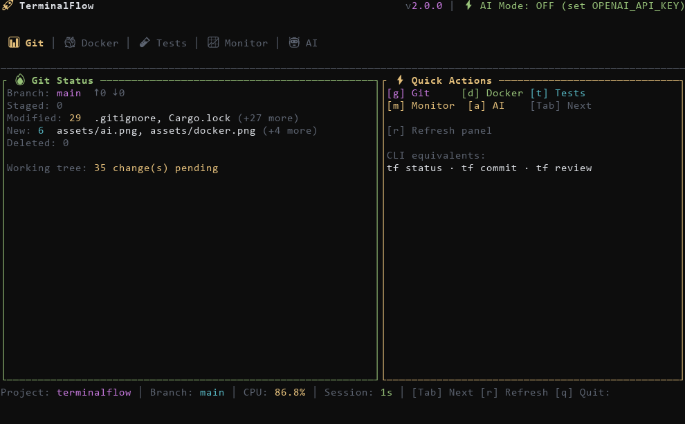
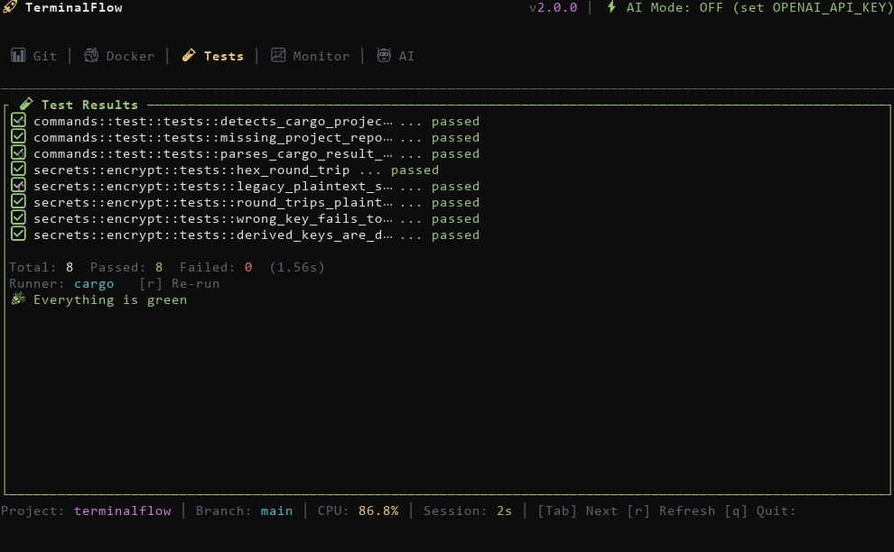
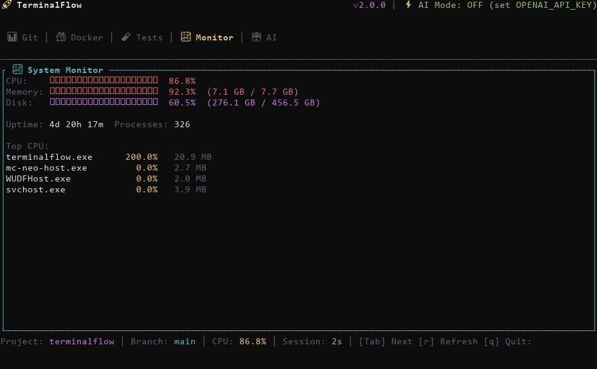
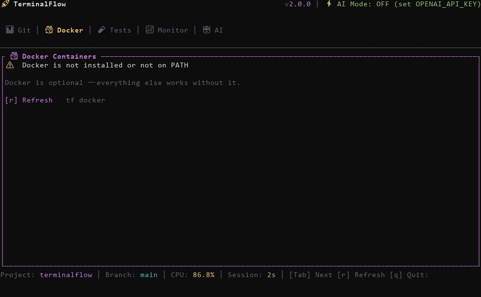
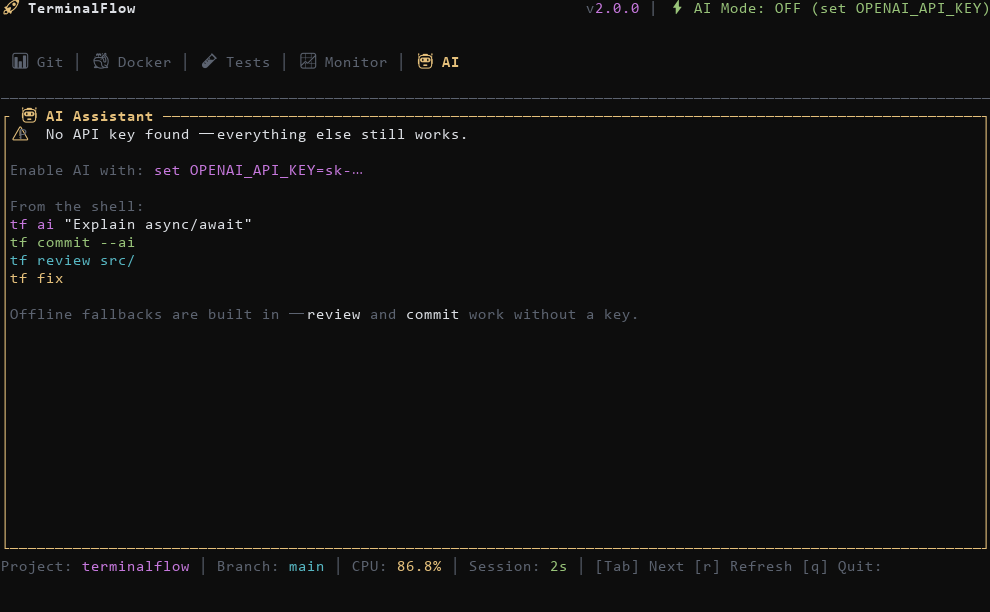

<div align="center">

# 🚀 TerminalFlow

### The AI-powered terminal dashboard that puts your whole dev workflow in one TUI

[](https://github.com/reyansh14coder-ux/terminalflow/stargazers)
[](https://github.com/reyansh14coder-ux/terminalflow/network/members)
[](https://github.com/reyansh14coder-ux/terminalflow/issues)
[](LICENSE)
[](https://github.com/reyansh14coder-ux/terminalflow/actions)

</div>

---

## 📸 Screenshots

Real screenshots generated from the running app — regenerate them any time with
`tf screenshot` + `python assets/render_screenshots.py`.

| 📊 Git | 🧪 Tests |
|--------|----------|
|  |  |

| 📈 Monitor | 🐳 Docker |
|------------|-----------|
|  |  |

| 🤖 AI |
|-------|
|  |

---

## ❓ What is TerminalFlow?

TerminalFlow is a single binary that replaces a folder full of half-remembered
commands: it shows your git state, system health, tests, containers and logs in
one interactive dashboard, and gives you sharp CLI subcommands for everything
else — **working offline, with AI as an optional upgrade**.

Everything you see is real data:

- `tf ps` / `tf monitor` — live processes, CPU, memory, disk via `sysinfo`
- `tf status` — real git status (staged / modified / untracked / ahead / behind)
- `tf test` — detects and runs `cargo`, `npm`, `pytest` or `go`
- `tf secret` / `tf vault` — encrypted at rest (XChaCha20-Poly1305 + PBKDF2)
- `tf review` / `tf commit` — work offline; upgrade to AI by setting a key

---

## ⚡ Quick Start

### Build from source

Requires [Rust](https://rustup.rs) (1.70+) and `git`:

```bash
git clone https://github.com/reyansh14coder-ux/terminalflow.git
cd terminalflow
cargo build --release
./target/release/terminalflow --help
```

### Prebuilt binaries

Windows / Linux / macOS builds are published on the
[Releases page](https://github.com/reyansh14coder-ux/terminalflow/releases)
(generated by CI when a version tag is pushed).

### Run it

```bash
tf                    # interactive dashboard (or: tf dashboard)
tf status             # styled git status
tf ps -c              # processes by CPU
tf monitor            # CPU / memory / disk + top processes
tf test               # run the project's test suite
tf review src/        # offline static review (AI if a key is set)
tf commit             # commit message from the diff (offline)
```

---

## 🎮 Dashboard keys

| Key | Action |
|-----|--------|
| `Tab` / `Shift+Tab` | Next / previous panel |
| `g` `d` `t` `m` `a` | Jump to Git / Docker / Tests / Monitor / AI |
| `r` | Refresh the active panel (re-run tests on the Tests panel) |
| `q`, then `y` | Quit |

---

## 🔧 Commands

| Command | What it does |
|---------|--------------|
| `tf dashboard` | Interactive TUI (default when run with no args) |
| `tf status` | Real git status: branch, staged, modified, untracked, ahead/behind |
| `tf commit [--ai]` | Conventional commit message from the staged diff |
| `tf review [path]` | Static review of the working diff — offline, or AI when a key is set |
| `tf fix` | Reads the last build error (or piped input) and suggests fixes |
| `tf test` | Detects cargo / npm / pytest / go and runs the suite |
| `tf ps [-c\|-m]` | Live process table, sorted by CPU or memory |
| `tf kill <pid>` | Kill a process (taskkill on Windows, kill on unix) |
| `tf monitor` | CPU, memory, disk bars + top processes |
| `tf logs <file>` | Parse logs: tail, `--level`, `--search`, stats summary |
| `tf http GET <url>` | HTTP client with `-H`, `--timeout`, JSON body via `--data` |
| `tf api create <name>` | Scaffold an API test file |
| `tf api test <file>` | Run API tests, report pass/fail |
| `tf secret set/get/list/delete` | Secrets encrypted at rest |
| `tf secret import <prefix>` | Import matching env vars into the vault |
| `tf vault unlock/lock/store/get/list/backup/restore` | Password-protected vault (PBKDF2 + XChaCha20-Poly1305) |
| `tf plugin list/search/install/uninstall/update` | Local folder or git-URL plugins |
| `tf ssh add/connect/list/remove` | Saved SSH connections |
| `tf docker` | Container list (needs Docker, gracefully absent otherwise) |
| `tf bisect start/test/reset` | Git bisect driven by `TF_BISECT_CMD` (default `cargo test`) |
| `tf gen struct/endpoint/tests` | Code scaffolding |
| `tf watch <path> -- <cmd>` | Re-run a command when files change |
| `tf serve [--port]` | Tiny HTTP server with `/health` |
| `tf ai "<question>"` | AI assistant |
| `tf screenshot` | Render the dashboard tabs to JSON (builds the screenshots above) |

---

## 🤖 AI setup (optional)

AI features light up when an API key is present — everything else works without one:

```bash
# Windows (PowerShell)
$env:OPENAI_API_KEY = "sk-…"

# macOS / Linux
export OPENAI_API_KEY=sk-…
```

- `tf ai`, `tf commit --ai`, `tf review --ai` use the key
- Without a key: `tf commit` builds a message from your diff offline,
  `tf review` runs the built-in static checks, and `tf ai` explains how to
  enable AI instead of failing
- Model/base URL overrides: `OPENAI_MODEL`, `OPENAI_BASE_URL`, `TF_OPENAI_API_KEY`

---

## 🔐 Secrets & vault

```bash
tf secret set DATABASE_URL "postgres://…"   # stored encrypted (AES-GCM-class AEAD)
tf secret get DATABASE_URL                  # decrypted on read
tf secret import AWS_                       # pull AWS_* env vars in
tf secret export-env --prefix MY_           # print as shell exports

tf vault unlock                             # password prompt (or TF_VAULT_PASSWORD)
tf vault store API_KEY "value"
tf vault get API_KEY
tf vault backup vault-backup.json           # entries stay encrypted
```

- Secrets are encrypted at rest with a key file in `~/.terminalflow/secrets/.key`
- The vault derives its key from your password (PBKDF2-HMAC-SHA256, 60k rounds)
- Values written before encryption existed still read fine (plaintext passthrough)

---

## 🧪 Testing

```bash
cargo test          # Rust unit tests
npm install && npm test   # Playwright e2e (tests/e2e)
```

Regenerate the screenshots:

```bash
tf screenshot --out assets/dashboard.json
python assets/render_screenshots.py     # needs Pillow: pip install pillow
```

---

## 🛠 Built With

- [ratatui](https://github.com/ratatui/ratatui) + [crossterm](https://github.com/crossterm-rs/crossterm) — TUI
- [sysinfo](https://github.com/GuillaumeGomez/sysinfo) — processes, CPU, memory, disks
- [git2](https://github.com/rust-lang/git2-rs) — git status without shelling out
- [reqwest](https://github.com/seanmonstar/reqwest) — HTTP client/server
- [clap](https://github.com/clap-rs/clap), [tokio](https://github.com/tokio-rs/tokio), [serde](https://github.com/serde-rs/serde)
- [chacha20poly1305](https://github.com/RustCrypto/AEADs) + [pbkdf2](https://github.com/RustCrypto/KDFs) — secret storage

---

## 🗺 Roadmap

- [ ] Timeline view for git history inside the dashboard
- [ ] Remote ahead/behind badge refresh while the dashboard is open
- [ ] More log formats (journald, JSON lines)
- [ ] Plugin marketplace index

Contributions welcome — see [CONTRIBUTING](CONTRIBUTING.md) and open an
[issue](https://github.com/reyansh14coder-ux/terminalflow/issues) or a
[pull request](https://github.com/reyansh14coder-ux/terminalflow/pulls).

---

## 📄 License

MIT — see [LICENSE](LICENSE).

---

<div align="center">

**[Report a bug](https://github.com/reyansh14coder-ux/terminalflow/issues)** ·
**[Request a feature](https://github.com/reyansh14coder-ux/terminalflow/issues)** ·
**[Releases](https://github.com/reyansh14coder-ux/terminalflow/releases)**

</div>
